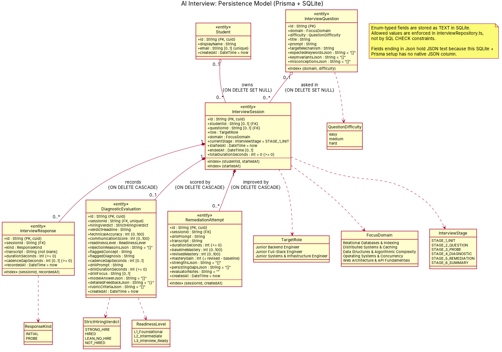
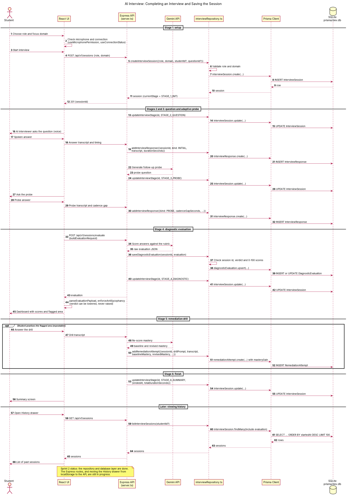

# UML Diagrams (Sprint 2)

| Diagram | Source | Rendered |
| --- | --- | --- |
| Class diagram: database entities, attributes, relationships and constraints | [class-diagram.puml](class-diagram.puml) | [PNG](class-diagram.png), [SVG](class-diagram.svg) |
| Sequence diagram: a student completes an interview and the session is saved | [sequence-diagram.puml](sequence-diagram.puml) | [PNG](sequence-diagram.png), [SVG](sequence-diagram.svg) |





## Regenerate

With PlantUML and Graphviz installed:

```bash
cd docs/uml
plantuml -tpng *.puml
plantuml -tsvg *.puml
```

Or use the PlantUML extension in VS Code.

The class diagram follows `prisma/schema.prisma`. If the schema changes, update the `.puml`
file and re-render. See [../ai-design-review.md](../ai-design-review.md) for how the diagrams
were reviewed.
